# Gavora ERP — Inventory & Sales Management System

Sistem Informasi Manajemen Inventaris dan Penjualan (Stock-In & Stock-Out) berbasis web yang dirancang khusus untuk memenuhi standar penilaian **Ujian Tengah Semester (UTS) Web Programming**. Sistem ini dibangun dengan arsitektur modern **Laravel 12**, **PHP 8.2+**, **MySQL**, **Eloquent ORM**, dan antarmuka responsif **Bootstrap 5.3 CDN**.

---

## 1. Project Overview & Masalah Bisnis yang Diselesaikan

Dalam operasional bisnis distribusi barang dan toko retail, sering kali terjadi inkonsistensi data inventaris akibat beberapa kelemahan sistem konvensional:
1. **Overselling & Race Condition**: Terjadinya penjualan melebihi sisa stok riil ketika beberapa pengguna/kasir melakukan transaksi secara bersamaan.
2. **Client-Side Price Manipulation**: Kerentanan transaksi di mana total harga atau harga satuan dihitung di browser dan dapat dimanipulasi melalui inspect element.
3. **Data Yatim (Orphan Records) & Rusaknya Laporan Keuangan**: Penghapusan produk, supplier, atau kategori yang sudah tercatat di faktur masa lalu sehingga laporan laba rugi menjadi rusak.
4. **Otorisasi Lemah**: Pembatasan hak akses yang hanya disembunyikan di tampilan Blade tanpa validasi server-side.

**Gavora ERP** menyelesaikan seluruh permasalahan tersebut melalui:
- **Pessimistic Locking (`lockForUpdate()`)** di dalam satu transaksi database atomik (`DB::transaction()`).
- **Kalkulasi Harga Murni di Sisi Server** berdasarkan harga master data resmi di database.
- **Proteksi Integritas Referensial Berlapis** (`restrictOnDelete` di migration dan pengecekan relasi `exists()` di Controller).
- **Server-Side Role Middleware** di `bootstrap/app.php` standar Laravel 12.

---

## 2. Entity Relationship Diagram (ERD) & Relasi Eloquent

### A. Diagram ERD (Mermaid)

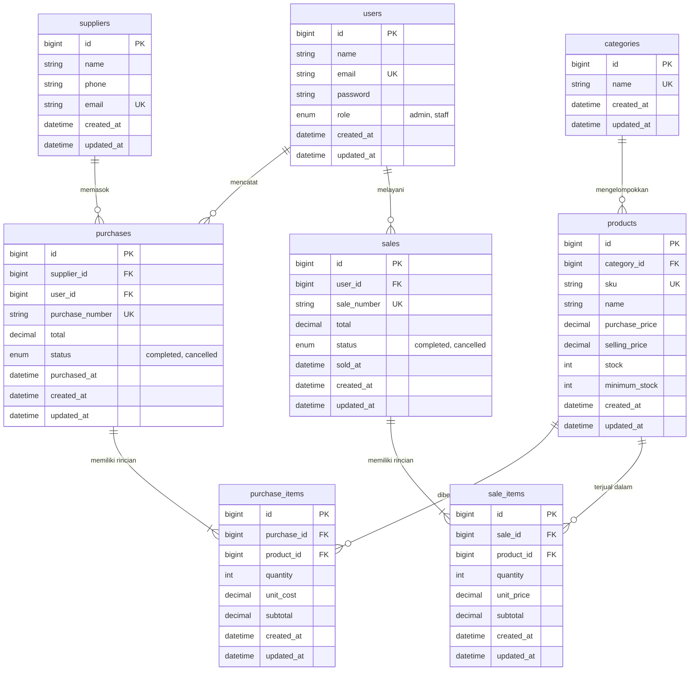

### B. Daftar Relasi Model Eloquent:
- **`Category`**: `hasMany(Product::class)`
- **`Product`**: `belongsTo(Category::class)`, `hasMany(PurchaseItem::class)`, `hasMany(SaleItem::class)`. Query scope `scopeLowStock()` & helper `hasTransactions()`.
- **`Supplier`**: `hasMany(Purchase::class)`
- **`Purchase`**: `belongsTo(Supplier::class)`, `belongsTo(User::class)`, `hasMany(PurchaseItem::class)`
- **`PurchaseItem`**: `belongsTo(Purchase::class)`, `belongsTo(Product::class)`
- **`Sale`**: `belongsTo(User::class)`, `hasMany(SaleItem::class)`
- **`SaleItem`**: `belongsTo(Sale::class)`, `belongsTo(Product::class)`
- **`User`**: `hasMany(Purchase::class)`, `hasMany(Sale::class)`. Helper `isAdmin(): bool` dan `isStaff(): bool`.

---

## 3. Kebutuhan Sistem (System Requirements)

- **PHP**: Versi 8.2 atau lebih baru (ekstensi: `pdo`, `pdo_mysql`, `mbstring`, `openssl`, `tokenizer`, `xml`, `ctype`, `json`, `bcmath`).
- **Composer**: Versi 2.x
- **Basis Data**: MySQL 8.x / MariaDB 10.4+ (kompatibel dengan XAMPP/Laragon)
- **Framework**: Laravel 12.x
- **Browser**: Modern Web Browser (Chrome, Firefox, Edge, Safari) dengan dukungan JavaScript aktif.

---

## 4. Panduan Instalasi (Step-by-Step Setup)

Jalankan perintah berikut pada terminal Anda:

```bash
# 1. Clone repository
git clone https://github.com/username/gavora-inventory.git
cd gavora-inventory

# 2. Instal dependensi Composer
composer install

# 3. Salin file environment
cp .env.example .env

# 4. Generate application key
php artisan key:generate

# 5. Konfigurasi koneksi MySQL pada file .env
# Buka file .env dan sesuaikan:
# DB_CONNECTION=mysql
# DB_HOST=127.0.0.1
# DB_PORT=3306
# DB_DATABASE=gavora
# DB_USERNAME=root
# DB_PASSWORD=

# 6. Buat database dan jalankan migrasi beserta seeder
php artisan migrate:fresh --seed

# 7. Jalankan server lokal
php artisan serve
```

Aplikasi dapat langsung diakses melalui URL: **`http://127.0.0.1:8000`**

---

## 5. Akun Uji Coba Demo (Seeded Accounts)

Untuk mempermudah pengujian saat pemeriksaan dosen, sistem telah dilengkapi akun bawaan realistis:

| Role | Nama Pengguna | Alamat Email | Password | Hak Akses Utama |
|---|---|---|---|---|
| **Admin (Owner)** | Admin Gudang & Toko | `admin@inventory.test` | `password123` | Akses penuh CRUD User, Kategori, Supplier, Produk, Laporan, Pembelian, Penjualan, & Pembatalan Transaksi |
| **Staff (Gudang)** | Budi Staff Inventory | `staff1@inventory.test` | `password123` | Read-only produk, Transaksi Pembelian (Stock-In), Transaksi Penjualan, Pantau Low-Stock |
| **Staff (Kasir)** | Siti Staff Kasir | `staff2@inventory.test` | `password123` | Read-only produk, Transaksi Penjualan (Stock-Out), Pantau Low-Stock |

---

## 6. Fitur Kunci & Aturan Bisnis Teruji

1. **Atomisitas Mutasi Stok & Pessimistic Locking**:
   - Seluruh mutasi stok pada `purchases` dan `sales` dieksekusi di dalam `DB::transaction()` dengan mengunci baris produk menggunakan `Product::lockForUpdate()`.
   - Menghilangkan celah *race condition* saat banyak pengguna bertransaksi secara serempak.
2. **Kalkulasi Harga Server-Side (Zero Trust Browser)**:
   - Form penjualan tidak mengirim harga final yang dapat diubah di browser. Server secara mandiri mengambil `selling_price` dari tabel `products` di database dan mengalikan kuantitas.
3. **Rollback Otomatis Saat Validasi Gagal**:
   - Jika satu item gagal validasi (misalnya stok produk kedua kurang), pelemparan `ValidationException` memicu rollback total database. Stok item pertama tetap utuh dan tidak ada header transaksi tersimpan.
4. **Proteksi Integritas Referensial**:
   - Produk, kategori, dan supplier yang sudah memiliki riwayat transaksi ditolak untuk dihapus (dilindungi oleh constraint database `restrictOnDelete` dan proteksi controller dengan flash alert yang jelas).
5. **Pembatalan Transaksi Terkendali (Admin Only)**:
   - Admin dapat membatalkan transaksi yang berstatus `completed`. Sistem akan mengembalikan/mengurangi stok produk secara proporsional di dalam transaksi database atomik.
6. **Deteksi Otomatis Stok Rendah (Low-Stock Alert)**:
   - Produk yang memiliki stok &le; `minimum_stock` secara otomatis diberi label bahaya pada katalog dan disajikan pada tabel khusus dashboard.

---

## 7. Screenshots Halaman Utama & Alur Transaksi (Deliverables UTS)

Berikut adalah dokumentasi tangkapan layar antarmuka sistem **Gavora ERP** untuk memenuhi standar penilaian **Deliverables UTS (Screenshots Halaman Utama & Transaksi)**:

### A. Halaman Utama & Monitoring Operasional

#### 1. Halaman Login & Autentikasi Pengguna
Halaman autentikasi aman dengan pemisahan hak akses berbasis peran (*Role-Based Access Control*). Dilengkapi tombol login instan 1-klik sebagai Customer untuk kemudahan pengujian dosen/asisten lab.
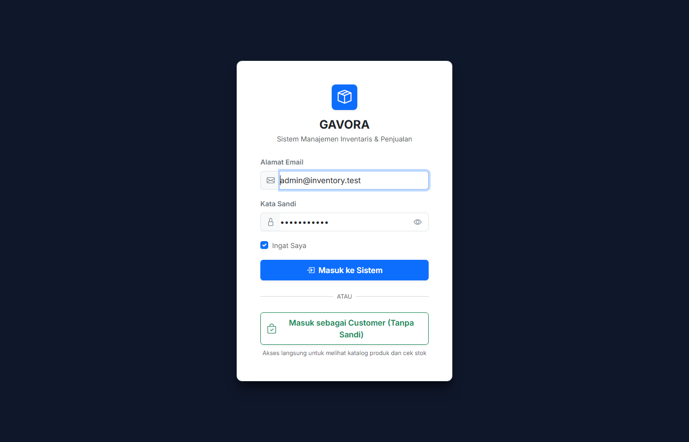

#### 2. Dashboard Utama Admin & Staff
Pusat analitik operasional dengan data agregat real-time dari database: Omzet Penjualan Hari Ini, Omzet Bulan Ini, Total Pengadaan Stok, Jumlah Master Produk Aktif, Peringatan Stok Rendah, dan Riwayat 5 Transaksi Terakhir.
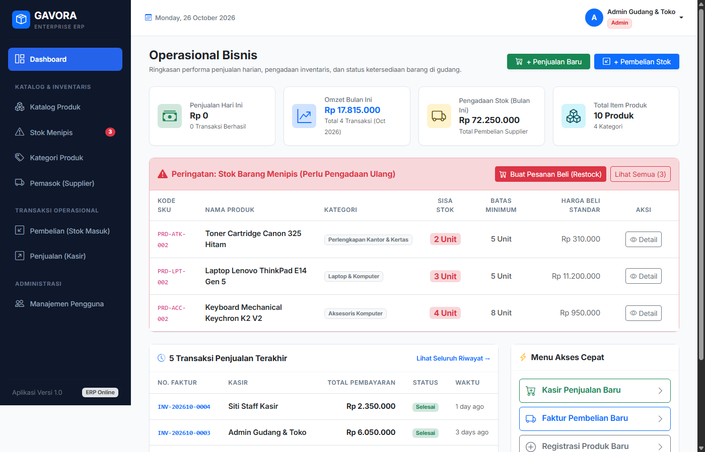

#### 3. Monitoring Stok Menipis (Audit Gudang / Low-Stock Alert)
Halaman audit inventaris otomatis menyaring produk dengan sisa stok &le; `minimum_stock`. Membantu staf gudang melakukan *restock* atau pemesanan ulang (*reorder*) tepat waktu sebelum terjadi kelangkaan barang.
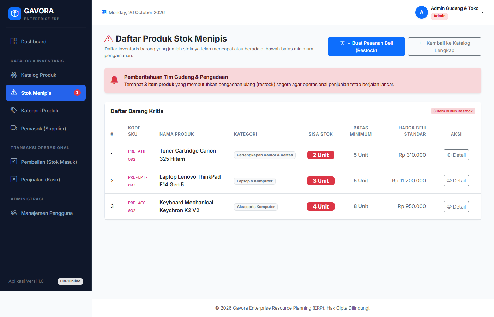

#### 4. Katalog & Master Data Produk
Katalog seluruh barang dagang dengan informasi SKU, kategori, harga beli, harga jual resmi, indikator status stok, serta navigasi pencarian dan filter kategori.
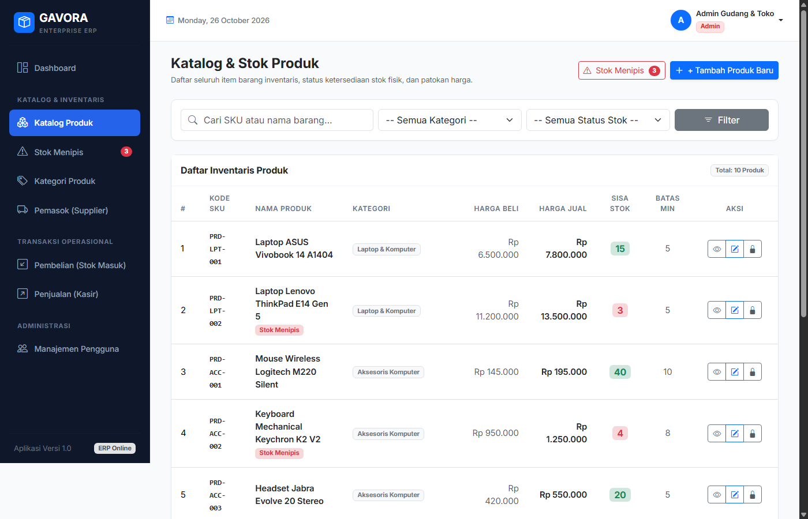

---

### B. Modul Transaksi Pembelian (Stock-In / Pengadaan Barang Masuk)

#### 5. Riwayat Transaksi Pembelian (Purchases Index)
Menampilkan seluruh catatan transaksi pengadaan barang dari mitra pemasok (supplier), dilengkapi nomor faktur unik (`PUR-YYYYMM-XXXX`), tanggal, total nominal modal, nama supplier, dan status transaksi.
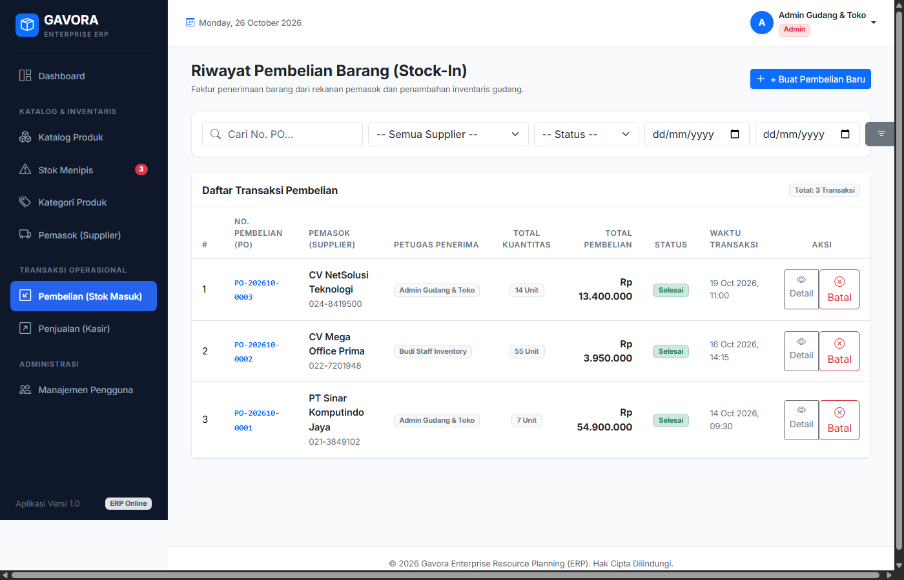

#### 6. Form Input Transaksi Pembelian Multi-Item (Stock-In Create)
Form transaksi dinamis yang memungkinkan staf gudang menambahkan beberapa varian barang sekaligus dalam satu transaksi pengadaan dengan kalkulasi otomatis subtotal dan grand total modal.
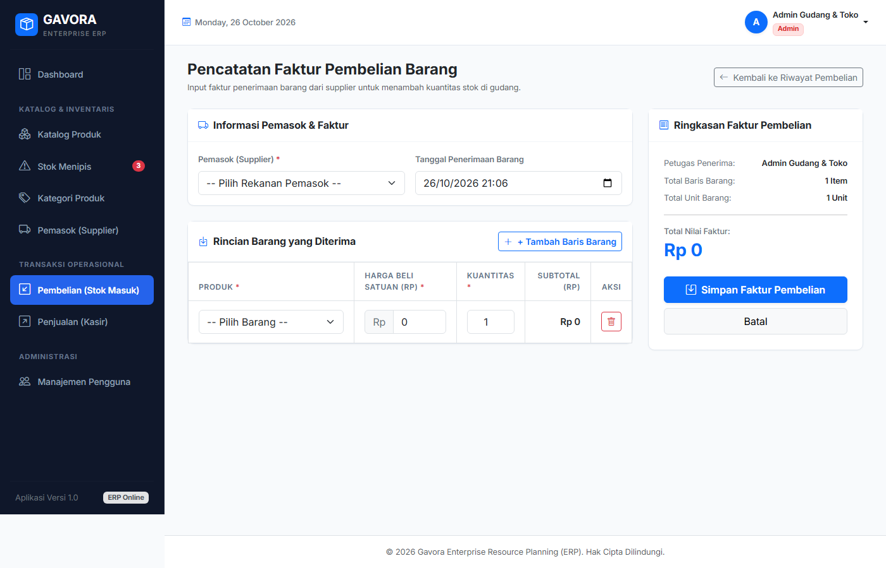

#### 7. Rincian Nota & Faktur Pembelian (Purchase Detail)
Bukti sah transaksi barang masuk yang merinci harga beli satuan, kuantitas per item, dan total pengeluaran modal. Admin berwenang membatalkan transaksi yang akan memicu mutasi pemotongan stok kembali secara atomik.
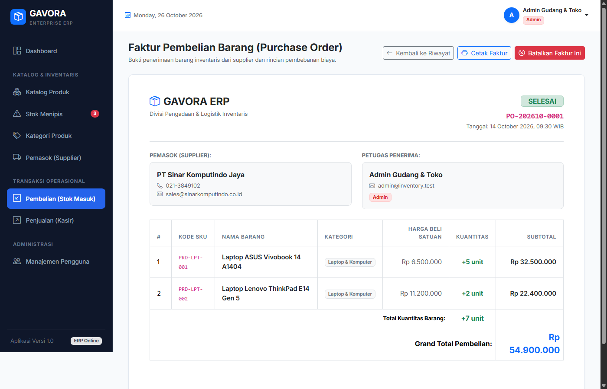

---

### C. Modul Transaksi Penjualan Kasir (Stock-Out / POS Retail)

#### 8. Riwayat Transaksi Penjualan (Sales Index)
Daftar seluruh transaksi penjualan barang kepada pelanggan dengan kode invoice resmi (`INV-YYYYMM-XXXX`), nama petugas kasir yang melayani, waktu transaksi, dan total pembayaran.
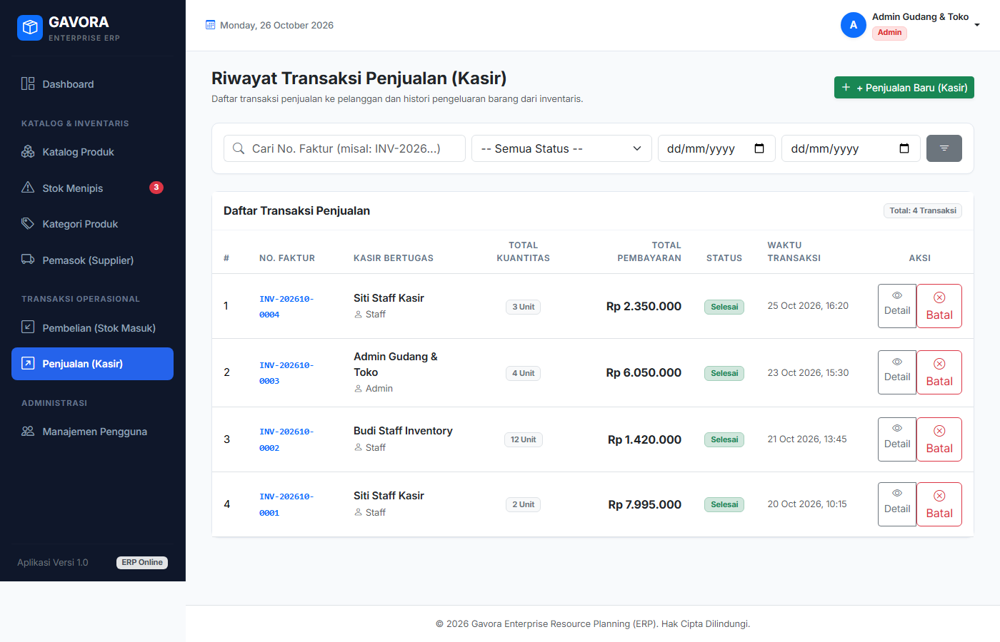

#### 9. Form POS Kasir Penjualan Multi-Item (Sales Create)
Antarmuka kasir modern dengan proteksi validasi stok real-time. Dilindungi *pessimistic locking* (`lockForUpdate`) untuk mencegah overselling ketika beberapa kasir bertransaksi serentak.
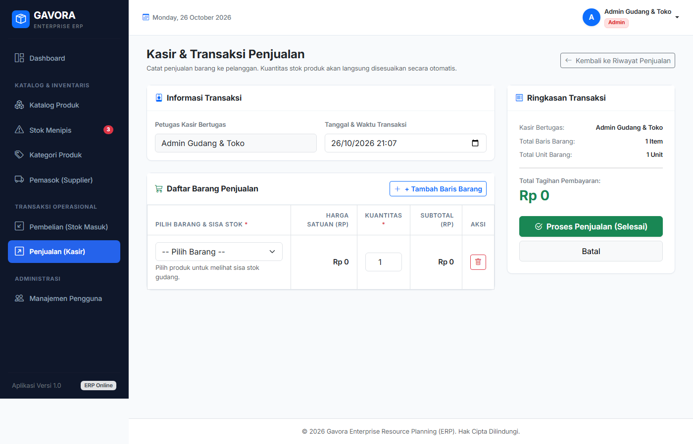

#### 10. Detail Struk Kasir & Faktur Penjualan (Sale Detail)
Faktur resmi penjualan yang menampilkan rincian barang yang terjual dengan kalkulasi harga mutlak dari basis data server (*Zero Client-Side Trust*).
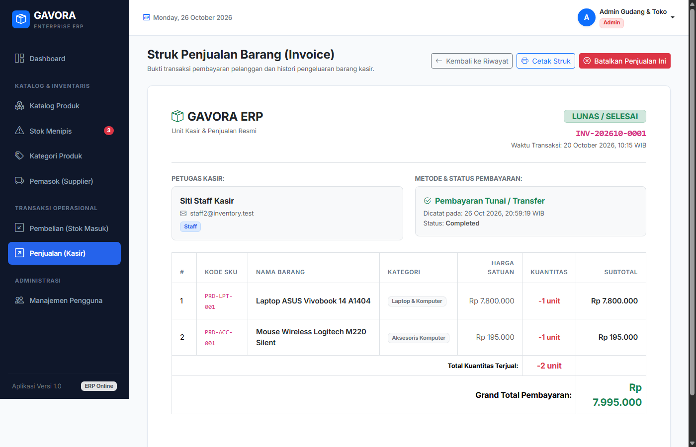

---

### D. Master Data Manajemen & Otorisasi Pengguna

#### 11. Master Data Kategori Produk
Pengelolaan kategori barang guna menjaga kerapian pengelompokan inventaris dan integritas relasi tabel database.
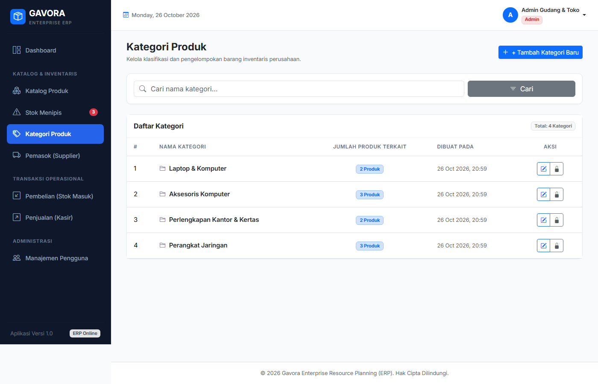

#### 12. Master Data Mitra Pemasok (Supplier)
Direktori vendor penyedia stok barang dagang dengan nomor kontak dan alamat surat elektronik resmi.
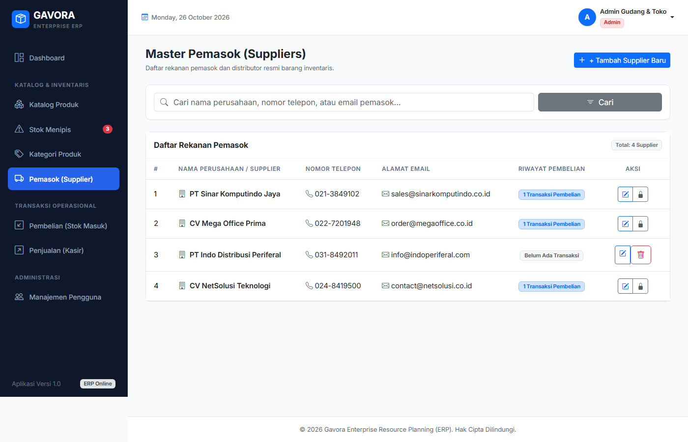

#### 13. Manajemen Pengguna & Otorisasi Karyawan
Pengelolaan akun pengguna berbasis peran (*Role-Based Access Control*) yang memisahkan kewenangan antara **Admin**, **Staff**, dan **Customer**.
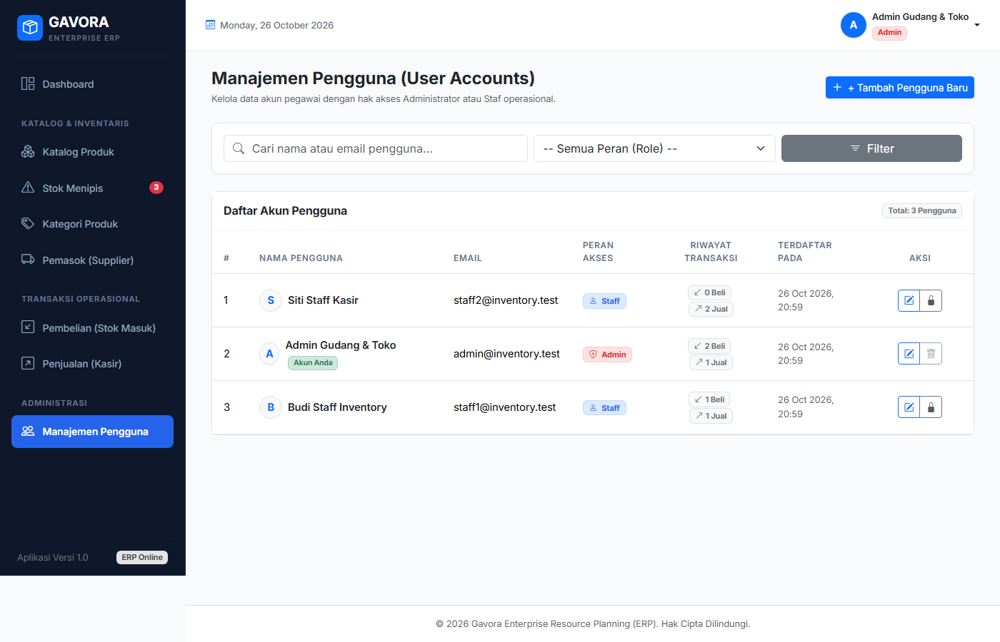

---

## 8. Instruksi & Hasil Pengujian Otomatis (Automated Feature Tests)

Untuk memvalidasi keandalan fungsional, integritas referensial, dan keamanan sistem, jalankan perintah pengujian Laravel berikut:

```bash
php artisan test
```

### Bukti Eksekusi Test Suite (20 Tests Passed, 105 Assertions):
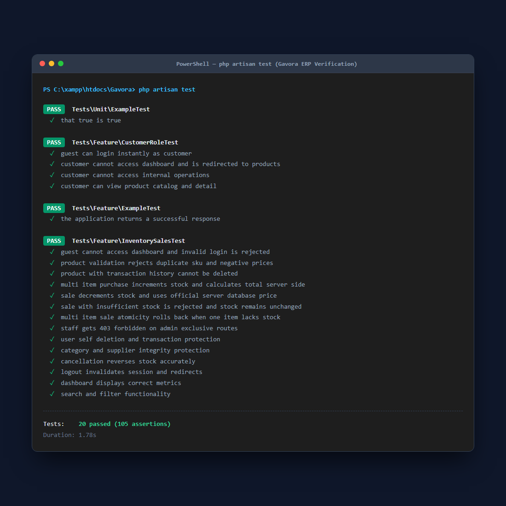

### Rincian Eksekusi Test Otomatis:
```text
   PASS  Tests\Unit\ExampleTest
  ✓ that true is true

   PASS  Tests\Feature\CustomerRoleTest
  ✓ guest can login instantly as customer
  ✓ customer cannot access dashboard and is redirected to products
  ✓ customer cannot access internal operations
  ✓ customer can view product catalog and detail

   PASS  Tests\Feature\ExampleTest
  ✓ the application returns a successful response

   PASS  Tests\Feature\InventorySalesTest
  ✓ guest cannot access dashboard and invalid login is rejected
  ✓ product validation rejects duplicate sku and negative prices
  ✓ product with transaction history cannot be deleted
  ✓ multi item purchase increments stock and calculates total server side
  ✓ sale decrements stock and uses official server database price
  ✓ sale with insufficient stock is rejected and stock remains unchanged
  ✓ multi item sale atomicity rolls back when one item lacks stock
  ✓ staff gets 403 forbidden on admin exclusive routes
  ✓ user self deletion and transaction protection
  ✓ category and supplier integrity protection
  ✓ cancellation reverses stock accurately
  ✓ logout invalidates session and redirects
  ✓ dashboard displays correct metrics
  ✓ search and filter functionality

  Tests:    20 passed (105 assertions)
  Duration: 1.78s
```

---

## 9. Batasan Sistem (Scope & Limitations)

- **Single Warehouse**: Sistem mengasumsikan satu titik lokasi gudang penyimpanan fisik.
- **Transaksi Selesai Tidak Dapat Diubah Parsial**: Untuk menjaga konsistensi audit trail buku besar, transaksi yang sudah selesai (`completed`) tidak dapat diedit sebagian, melainkan harus dibatalkan (`cancelled`) oleh Admin dan dibuatkan transaksi baru.
- **Presisi Mata Uang**: Menggunakan tipe data `decimal(15,2)` untuk menjamin akurasi perhitungan nominal Rupiah tanpa distorsi pembulatan floating-point.

---

## 10. Bekal Jawaban Code Interview Dosen (UTS Cheatsheet)

### Q1: Di mana middleware alias didaftarkan pada Laravel 12? Mengapa tidak ada file `app/Http/Kernel.php`?
> **Jawaban:** Pada Laravel 11 dan 12, struktur kernel telah dirampingkan. File `app/Http/Kernel.php` sudah dihapus oleh Laravel. Seluruh pendaftaran middleware global maupun alias kini dilakukan di file `bootstrap/app.php` menggunakan fungsi builder `->withMiddleware(function (Middleware $middleware) { $middleware->alias(['role' => \App\Http\Middleware\RoleMiddleware::class]); })`.

### Q2: Bagaimana cara sistem mencegah *race condition* atau *overselling* saat dua kasir menjual barang yang sama secara bersamaan?
> **Jawaban:** Sistem mengimplementasikan *pessimistic locking* pada level basis data menggunakan metode Eloquent `Product::lockForUpdate()->findOrFail($id)` di dalam blok `DB::transaction()`. Perintah ini mengeksekusi query SQL `SELECT ... FOR UPDATE`, yang secara eksklusif mengunci baris produk tersebut hingga transaksi pertama commit. Request kedua akan menunggu giliran antrean sehingga pembacaan stok selalu konsisten dan akurat.

### Q3: Mengapa form edit produk tidak mengizinkan pengubahan stok secara manual?
> **Jawaban:** Untuk mempertahankan integritas audit inventaris (*Stock Ledger Integrity*). Kuantitas stok produk hanya boleh bermutasi melalui dua kanal sah: penambahan lewat transaksi Pembelian (**Stock-In**) atau pengurangan lewat transaksi Penjualan (**Stock-Out**). Mengubah stok sembarangan pada form edit produk akan merusak keselarasan antara fisik barang dengan riwayat faktur transaksi akuntansi.

### Q4: Mengapa harga penjualan tidak boleh diambil dari input request browser?
> **Jawaban:** Input dari browser (HTTP Request) berada di luar kendali server dan rentan terhadap manipulasi (*parameter tampering* melalui Inspect Element atau Postman). Sistem kami menerapkan prinsip *Zero Client Trust* di mana harga satuan produk selalu diambil langsung dari kolom `selling_price` di database server, kemudian dikalikan dengan kuantitas yang divalidasi.

---

&copy; 2026 **Gavora ERP** — Disusun untuk Ujian Tengah Semester (UTS) Web Programming.
